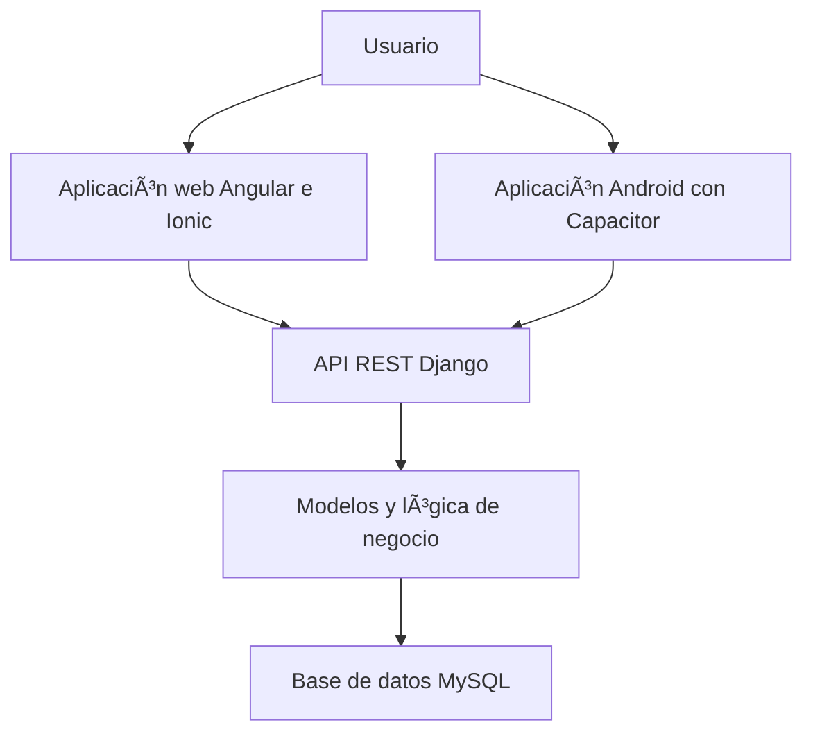
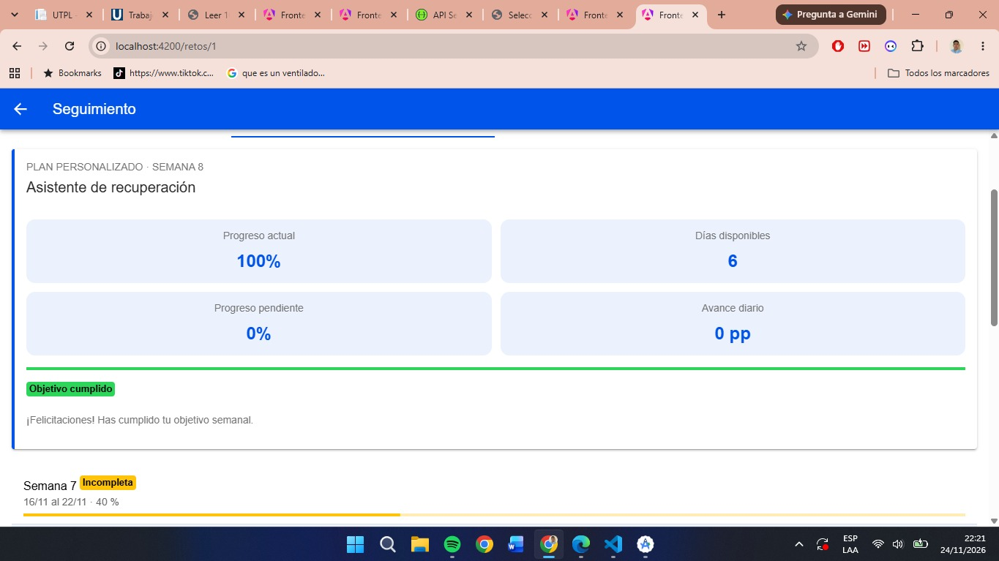
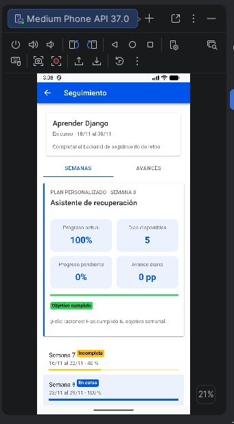

# Seguimiento de Retos

## 1. Información general

- Universidad: Universidad Técnica Particular de Loja (UTPL).
- Autor: Jorge Granda.
- Proyecto: Seguimiento de Retos.
- Modalidad: Individual.
- Plataformas: Web y Android.
- Año: 2026.

## 2. Descripción del proyecto

Seguimiento de Retos es una aplicación web y móvil
que permite gestionar objetivos personales mediante
el registro de avances y el seguimiento semanal.

El sistema incorpora un semáforo de cumplimiento,
alertas preventivas, validaciones de fechas y un
asistente de recuperación que genera recomendaciones
personalizadas para alcanzar los objetivos semanales.

## 3. Objetivos

### Objetivo general

Desarrollar una aplicación multiplataforma que permita
gestionar retos personales, controlar su progreso y
facilitar el cumplimiento de objetivos semanales.

### Objetivos específicos

- Implementar una API REST utilizando Django.
- Gestionar la persistencia de datos mediante MySQL.
- Desarrollar una interfaz web con Angular e Ionic.
- Integrar la aplicación con Android mediante Capacitor.
- Implementar alertas y un semáforo de cumplimiento.
- Incorporar una funcionalidad propia de recuperación.
- Validar el funcionamiento mediante pruebas unitarias.

## 4. Tecnologías utilizadas

| Tecnología | Función |
|---|---|
| Python | Lenguaje del backend |
| Django | Framework del backend |
| Django REST Framework | API REST |
| MySQL | Base de datos |
| Angular | Framework del frontend |
| TypeScript | Lenguaje del frontend |
| Ionic | Componentes de interfaz |
| Capacitor | Integración con Android |
| Android Studio | Compilación y emulación móvil |
| Vitest | Pruebas del frontend |
| Git | Control de versiones |
| Visual Studio Code | Entorno de desarrollo |

## 5. Arquitectura del sistema

La aplicación utiliza una arquitectura cliente-servidor,
separando la interfaz, la lógica del backend y la
persistencia de datos.



El frontend consume los servicios del backend mediante
peticiones HTTP. Tanto la aplicación web como la móvil
utilizan la misma API y base de datos.

## 6. Estructura del proyecto

```text
SeguimientoReto/
├── backend/
│   ├── config/
│   ├── retos/
│   └── manage.py
├── frontend/
│   ├── android/
│   ├── src/
│   │   └── app/
│   │       ├── core/
│   │       └── paginas/
│   ├── angular.json
│   ├── capacitor.config.ts
│   └── package.json
├── Documentacion/
├── .gitignore
└── README.md
```

## 7. Instalación y ejecución

### 7.1. Requisitos previos

- Python.
- Node.js y npm.
- MySQL.
- Android Studio.
- Android SDK.
- Java JDK.
- Git.

### 7.2. Backend

Ingresar al directorio del backend:

```powershell
cd backend
```

Crear y activar el entorno virtual:

```powershell
python -m venv .venv
.\.venv\Scripts\Activate.ps1
```

Instalar las dependencias:

```powershell
pip install -r requirements.txt
```

Configurar las variables de entorno utilizando
el archivo `.env.example` como referencia.

Crear la base de datos MySQL y configurar las
credenciales correspondientes en el archivo `.env`.

Aplicar las migraciones:

```powershell
python manage.py migrate
```

Crear un usuario administrador, si es necesario:

```powershell
python manage.py createsuperuser
```

Iniciar el servidor:

```powershell
python manage.py runserver 0.0.0.0:8000 --noreload
```

Direcciones disponibles:

- API REST: http://localhost:8000/api/
- Administración: http://localhost:8000/admin/
- Documentación API: http://localhost:8000/api/docs/

### 7.3. Frontend web

Desde la raíz del proyecto:

```powershell
cd frontend
npm.cmd install
npm.cmd start
```

Abrir en el navegador:

http://localhost:4200/

### 7.4. Aplicación Android

Desde el directorio frontend:

```powershell
npm.cmd run build
npx.cmd cap sync android
npx.cmd cap open android
```

Seleccionar un dispositivo virtual en Android Studio
y ejecutar la aplicación.

El backend debe permanecer activo durante la ejecución.

La aplicación Android utiliza la dirección
http://10.0.2.2:8000 para acceder al servidor local
desde el emulador.

## 8. Funcionalidades implementadas

- Creación y consulta de retos personales.
- Búsqueda de retos.
- Visualización del detalle de cada reto.
- Seguimiento de las semanas 7 a 15.
- Registro de porcentajes de cumplimiento.
- Registro de avances.
- Guardado automático del progreso semanal.
- Semáforo de cumplimiento.
- Alertas de semanas en riesgo.
- Bloqueo de modificaciones en semanas cerradas.
- Validación de errores mediante la API REST.
- Ejecución de la aplicación en Android.
- Asistente personalizado de recuperación de retos.

## 9. Semáforo de cumplimiento

| Estado | Descripción |
|---|---|
| Por iniciar | La semana todavía no comienza |
| En curso | La semana está activa |
| Verde | Semana cerrada con cumplimiento del 100% |
| Amarillo | Semana cerrada con cumplimiento entre 10% y menos de 100% |
| Rojo | Semana cerrada con cumplimiento inferior al 10% |

El sistema genera una alerta preventiva cuando una
semana activa tiene menos del 10% de progreso y
faltan dos días o menos para su cierre.

Las semanas cerradas no pueden modificarse.
Esta restricción se aplica también en el backend.

## 10. Funcionalidad propia

### Asistente de recuperación de retos

### 10.1. Problema identificado

El seguimiento tradicional permite conocer el porcentaje
de cumplimiento de un reto, pero no necesariamente
orienta al usuario sobre cuánto debe avanzar diariamente
para alcanzar su objetivo antes del cierre semanal.

### 10.2. Solución propuesta

Se desarrolló un asistente de recuperación que analiza
el porcentaje actual y los días disponibles para generar
un plan personalizado de cumplimiento.

La funcionalidad transforma los datos de seguimiento
en recomendaciones prácticas para el usuario.

### 10.3. Características

- Cálculo del porcentaje pendiente.
- Identificación de los días disponibles.
- Recomendación del avance diario.
- Generación de metas acumuladas por día.
- Recálculo automático al modificar el progreso.
- Identificación de situaciones urgentes.
- Reconocimiento de objetivos completados.
- Visualización mediante indicadores y barras de progreso.
- Disponibilidad tanto en la web como en Android.

### 10.4. Algoritmo utilizado

El algoritmo utiliza las siguientes reglas:

1. Porcentaje pendiente = 100 - porcentaje actual.
2. Días disponibles = días restantes + 1.
3. Avance diario = porcentaje pendiente / días disponibles,
   redondeado hacia arriba.
4. Las metas acumuladas se distribuyen entre los días
   disponibles hasta alcanzar el 100%.

Se incluye el día actual como una oportunidad de avance.

Cuando el avance diario recomendado es igual o superior
a 30 puntos porcentuales, el asistente indica una
situación de atención prioritaria.

Si el porcentaje alcanza el 100%, se muestra un mensaje
de felicitación y se elimina el plan de recuperación.

El asistente se muestra únicamente en semanas activas.

### 10.5. Ejemplo de funcionamiento

Para una semana con un progreso del 40% y cinco
días disponibles:

| Indicador | Resultado |
|---|---|
| Progreso actual | 40% |
| Progreso pendiente | 60% |
| Días disponibles | 5 |
| Avance diario recomendado | 12 puntos porcentuales |

Plan generado:

| Día | Meta acumulada |
|---|---:|
| Hoy | 52% |
| Día 2 | 64% |
| Día 3 | 76% |
| Día 4 | 88% |
| Día 5 | 100% |

### 10.6. Archivos desarrollados y modificados

| Archivo | Descripción |
|---|---|
| frontend/src/app/core/recuperacion.ts | Algoritmo y modelos del plan de recuperación |
| frontend/src/app/core/recuperacion.spec.ts | Seis pruebas unitarias del asistente |
| frontend/src/app/paginas/reto-detalle.page.ts | Integración visual y funcional del asistente |
| frontend/src/app/app.spec.ts | Adaptación de las pruebas a Angular e Ionic |

### 10.7. Aporte personal

La funcionalidad aporta valor al convertir el porcentaje
de cumplimiento en un plan de acción diario.

A diferencia de una alerta que únicamente informa sobre
un problema, el asistente propone metas concretas para
facilitar la recuperación del progreso.

La solución utiliza un algoritmo determinista basado
en reglas y cálculos matemáticos. No requiere servicios
externos de inteligencia artificial ni genera costos
adicionales por consumo de API.

La lógica se encuentra separada de la interfaz gráfica,
facilitando su mantenimiento, reutilización y validación.

## 11. Pruebas unitarias

### 11.1. Backend

Ejecutar desde el directorio backend:

```powershell
python manage.py test retos
```

Resultado obtenido: 5 pruebas aprobadas.

### 11.2. Frontend

Ejecutar desde el directorio frontend:

```powershell
npx.cmd ng test --watch=false
```

Resultados obtenidos:

| Componente | Aprobadas |
|---|---:|
| Semáforo | 8/8 |
| Componente principal | 2/2 |
| Asistente de recuperación | 6/6 |
| Total frontend | 16/16 |

### 11.3. Pruebas de la funcionalidad propia

| Caso de prueba | Resultado |
|---|---|
| Cálculo desde un progreso del 0% | Aprobado |
| Recálculo con progreso del 40% | Aprobado |
| Generación de metas hasta el 100% | Aprobado |
| Reconocimiento del objetivo completado | Aprobado |
| Detección de situación urgente | Aprobado |
| Ausencia de metas para una semana cerrada | Aprobado |

### 11.4. Resumen general

- Backend: 5 pruebas aprobadas.
- Frontend: 16 pruebas aprobadas.
- Total: 21 pruebas aprobadas.
- Compilación del frontend: exitosa.
- Sincronización con Android: exitosa.
- Asistente en navegador web: verificado.
- Asistente en emulador Android: verificado.

## 12. Evidencias

Las evidencias del proyecto se encuentran organizadas
en el directorio [Documentacion/evidencias](Documentacion/evidencias).

### 12.1. Evidencias del desarrollo inicial

- [Evidencias iniciales del proyecto](Documentacion/evidencias/Evidencias_Iniciales.pdf)
- [Backend y pruebas](Documentacion/evidencias/01_Backend)
- [Frontend web](Documentacion/evidencias/02_Frontend_Web)
- [Aplicación Android](Documentacion/evidencias/03_Android)
- [Integración](Documentacion/evidencias/04_Integracion)
- [Semáforo y alertas](Documentacion/evidencias/05_Semaforo_y_Alertas)

### 12.2. Funcionalidad propia: Asistente de recuperación

#### Evidencia 1. Asistente de recuperación en la web

Visualización del plan de recuperación a partir del
porcentaje actual y los días disponibles.


#### Evidencia 2. Recálculo automático en la web

Actualización automática de las recomendaciones
y metas diarias al modificar el porcentaje de avance.


#### Evidencia 3. Objetivo cumplido en la web

Reconocimiento del cumplimiento del 100% y
presentación del mensaje de felicitación.



#### Evidencia 4. Pruebas unitarias

Ejecución exitosa de las 16 pruebas del frontend,
incluyendo las seis pruebas del asistente de recuperación.


#### Evidencia 5. Objetivo cumplido en Android

Verificación del reconocimiento del objetivo
completado desde la aplicación móvil.



#### Evidencia 6. Recálculo automático en Android

Verificación del plan de recuperación con un avance
del 40%, cinco días disponibles y una recomendación
de 12 puntos porcentuales diarios.


## 13. Seguridad y buenas prácticas

- Uso de variables de entorno.
- Exclusión de credenciales del control de versiones.
- Validación de datos en el frontend y backend.
- Restricción de modificaciones en semanas cerradas.
- Separación de responsabilidades.
- Reutilización de componentes.
- Pruebas unitarias.
- Control de versiones mediante Git.

## 14. Conclusiones

El desarrollo del proyecto permitió integrar tecnologías
de backend, frontend y desarrollo móvil dentro de una
misma solución.

La implementación del asistente de recuperación amplía
las capacidades del seguimiento tradicional al proporcionar
recomendaciones personalizadas y metas diarias.

Las pruebas unitarias y las verificaciones realizadas
en el navegador y en Android respaldan el funcionamiento
de los componentes evaluados.

El proyecto constituye una solución multiplataforma
que facilita la organización, el seguimiento y el
cumplimiento de objetivos personales.

---

